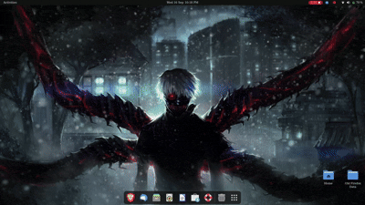
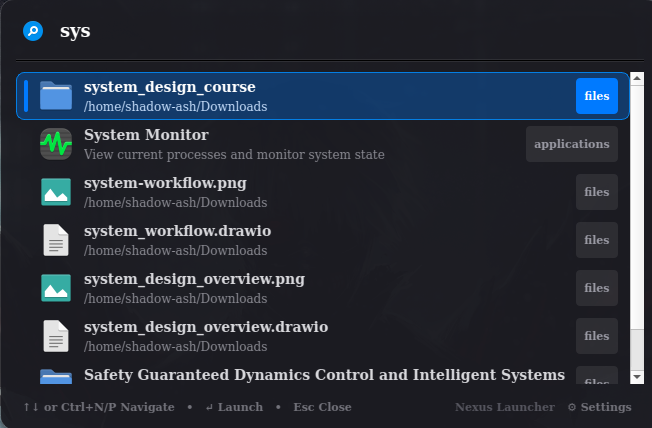
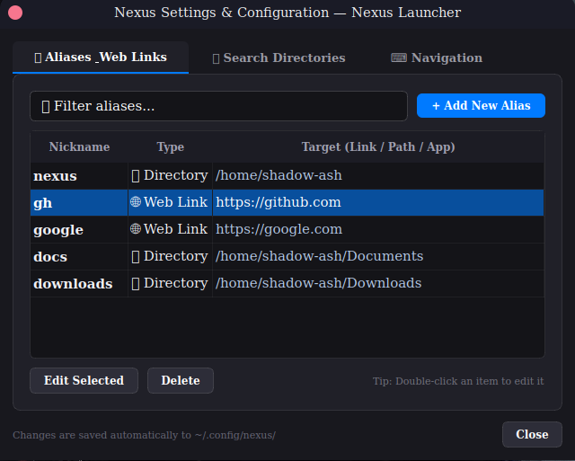
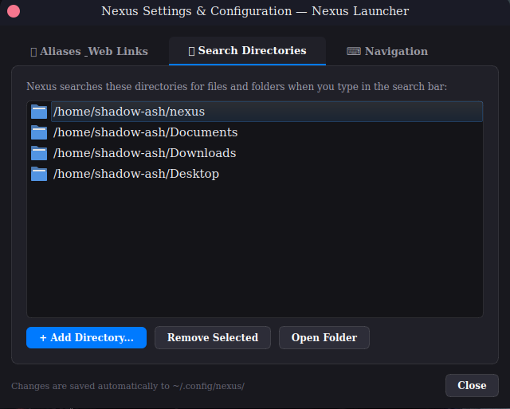
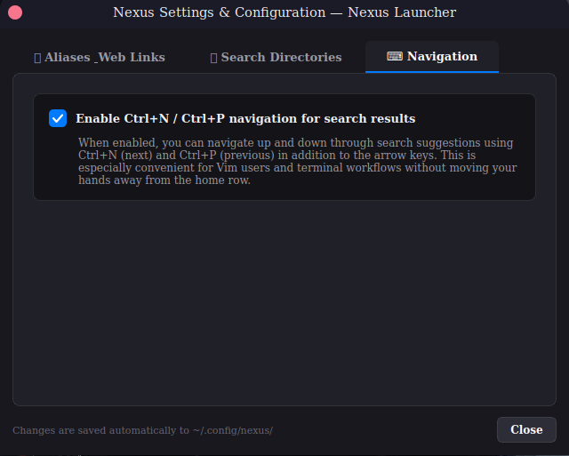

# Nexus

A fast, keyboard-first productivity launcher for Linux.

Press `Alt + Space`, type, press Enter. Nexus finds applications, evaluates expressions, opens files and folders, runs shell commands, and resolves your own aliases — from one window, without touching the mouse.

> **Version 0.7.0.** Nexus is usable daily on X11 and is the author's primary launcher. It is not feature-complete: Wayland hotkey support (desktop portal or a GNOME shortcut button) is new and lightly tested, and a few rough edges are listed under [Not implemented yet](#not-implemented-yet) and [Known issues](#known-issues). Read both before installing.



<table>
  <tr>
    <td align="center">
      <br>
    </td>
    <td align="center">
      <br>
    </td>
  </tr>
  <tr>
    <td align="center">
      <br>
    </td>
    <td align="center">
      <br>
    </td>
  </tr>
</table>


## Why this exists

A Linux desktop scatters simple actions across separate tools: an application menu to launch things, a file manager to find things, a terminal to run things, a browser to look things up, a calculator for arithmetic. Each one costs a context switch.

Nexus collapses those into a single keystroke. It is built around four ideas:

- **Speed is a feature.** A launcher that takes 300 ms to appear is a launcher you stop using.
- **Local-first.** Everything works offline. No account, no telemetry, no network calls unless a provider explicitly makes one.
- **Separation of retrieval and ranking.** Providers find candidates; a separate ranking engine decides the order. Adding a source never means touching ranking logic.
- **No AI for its own sake.** Lexical search is the foundation. Semantic search is a later, optional, measured addition — not a headline.


## What works today

| Feature | How to use it |
|---|---|
| Application search | Type any part of a name, generic name, keyword or comment |
| Fuzzy matching | `vsc` → Visual Studio Code |
| Usage-aware ranking | Apps you launch rise for that search and similar ones; recent launches count a little more; an exact name match always stays on top |
| Calculator | `calc 125 * 37`, `calc sqrt(144)`, `calc 2^10`, or type a bare expression |
| Unit conversion | `120 km in miles`, `72 f to c`, `5 GB to MB`, `-5c to f` (also `to`); length, weight, temperature, data size, time, volume (litres, US gallons) and speed. `MB` is megabytes, `Mb` megabits; enter copies the number |
| File & folder search | `file thesis.pdf` searches an index of your configured directories, kept current as files change |
| Open URL | Type `github.com/x`, `https://example.com` or `localhost:8080`; Enter opens it in your browser (only http and https; a bare file name like `notes.txt` is not treated as an address) |
| Shell commands | `> docker ps` — the `>` prefix is required, never implicit. Commands that look destructive (`rm -rf`, `dd`, `mkfs`, `shutdown`, ...) ask yes/no first (default No), also when run through an alias. If a command exits with an error, a tray message shows its exit status |
| Aliases | `alias gh https://github.com`, then type `gh` |
| Web search | `web rust lifetimes` opens a search in your browser (DuckDuckGo by default; a plugin, needs Python 3) |
| Clipboard history | `clip` followed by text searches what you copied since Nexus started; Enter copies an entry again. `clip ` alone lists the whole history, newest first. `clip clear` empties the history |
| System actions | Type `lock`, `sleep`, `logout`, `restart` or `shutdown` (a plugin, needs Python 3). Restart, shut down and log out ask "Run ...?" first; the answer defaults to No |
| Plugins | Add your own search sources in any language, run as separate processes. See [docs/plugins.md](docs/plugins.md) |
| Settings | Type `settings`, or run `nexus settings`: aliases, directories and exclusions, result count, search sources, shortcut, theme, history |
| Themes | Dark (default), light, or follow the desktop |
| History controls | Turn history off in Settings, or wipe it with `nexus history clear` |
| Tray icon | Toggle, open settings, rebuild indexes, quit |
| New apps appear automatically | While Nexus runs, installing or removing an application updates search within seconds. Apps installed while it was off are picked up at the next start |
| Single instance | Launching Nexus again toggles the running window instead of starting a second copy |

**Keys**

```
Alt + Space     Show / hide the launcher (configurable in Settings)
↑ / ↓           Navigate results
Ctrl + N / P    Navigate results (optional, on by default)
Enter           Execute the selected result
Esc             Close
```


## Not implemented yet

Listed honestly so you know what you are getting. These are planned — see the [roadmap](#roadmap).

- **`.deb` and AppImage packages.** Install from source with `cmake --install`.


## Known issues

- **Wayland hotkey without the portal.** On Wayland desktops that have neither the `GlobalShortcuts` portal nor GNOME, bind `nexus --toggle` yourself in the compositor's settings. See [Wayland](#wayland).


## Requirements

- Linux, X11 or Wayland session (for the Wayland hotkey see [Wayland](#wayland))
- CMake 3.22 or newer
- A C++20 compiler (GCC 11+ or Clang 14+)
- Qt — `Core`, `Gui`, `Widgets`, `Network`, `DBus`. Developed and tested against **Qt 5.15.3**. Qt 6 builds successfully and is covered by CI, but has had far less real-world testing — see [Known Qt6 differences](#known-qt6-differences) if you hit anything.
- SQLite 3 development headers
- Python 3 (standard library only), only for the shipped `web` and `system` plugins
- libX11 development headers

**Debian / Ubuntu**

```bash
sudo apt install build-essential cmake \
  qt6-base-dev libsqlite3-dev libx11-dev
```

**Fedora**

```bash
sudo dnf install gcc-c++ cmake \
  qt6-qtbase-devel sqlite-devel libX11-devel
```

**Arch**

```bash
sudo pacman -S base-devel cmake qt6-base sqlite libx11
```


## Build

```bash
git clone https://github.com/mawaissaleem/Nexus.git
cd Nexus
cmake -B build -DCMAKE_BUILD_TYPE=Release
cmake --build build -j$(nproc)
```

The binary lands at `build/nexus`.

**Run it**

```bash
./build/nexus
```

Nexus starts in the background, registers the hotkey, and shows the window once so you know it is alive. Press `Alt + Space` from anywhere after that.

**Install system-wide**

```bash
sudo cmake --install build
```

Install from the Release build above; the [Tests](#tests) steps use a separate `build-debug/` directory. This installs `nexus` to `/usr/local/bin/`, `nexus.desktop` to `/usr/local/share/applications/`, the systemd user unit `nexus.service` to `/usr/local/lib/systemd/user/` and the web and system plugins to `/usr/local/share/nexus/plugins/`, which Nexus reads when `XDG_DATA_DIRS` is unset or includes `/usr/local/share`. Otherwise, copy them for your user only: `mkdir -p "${XDG_DATA_HOME:-$HOME/.local/share}/nexus/plugins" && cp -r plugins/web plugins/system "${XDG_DATA_HOME:-$HOME/.local/share}/nexus/plugins/"`. They need Python 3. Restart Nexus afterwards; plugins are found at startup.

**Start on login**

`cmake --install` also installs a systemd user unit (if you followed an older README and wrote your own `~/.config/systemd/user/nexus.service`, delete it first, since it takes precedence over the installed unit), so after installing run:

```bash
systemctl --user enable --now nexus.service
```

If you installed to `~/.local` instead, systemd does not look in `~/.local/lib/systemd/user`; pass the full path, which links the unit into `~/.config/systemd/user/`: `systemctl --user enable --now ~/.local/lib/systemd/user/nexus.service`.

The unit starts with `graphical-session.target` and takes its display from the systemd user environment. Built with Qt 5, Nexus runs on X11, through XWayland on a Wayland desktop, so it needs `DISPLAY` even there. It runs natively on Wayland, and then needs `WAYLAND_DISPLAY`, only when `XDG_SESSION_TYPE=wayland` is set on a desktop other than GNOME, or when you set `QT_QPA_PLATFORM=wayland`. Nexus also reads `XDG_SESSION_TYPE` and `XDG_CURRENT_DESKTOP` to pick its Wayland hotkey route (see [Wayland](#wayland)). GNOME, KDE and other full desktops provide all of these. With a bare window manager, use the autostart alternative below, or have its startup script run `systemctl --user import-environment DISPLAY WAYLAND_DISPLAY XAUTHORITY XDG_SESSION_TYPE XDG_CURRENT_DESKTOP && systemctl --user start nexus.service`.

Alternative, XDG autostart (if your window manager doesn't run it, put `nexus` in its startup script): `mkdir -p ~/.config/autostart && cp /usr/local/share/applications/nexus.desktop ~/.config/autostart/`.


## Command line

Nexus is usable without the GUI, which also makes it scriptable and bindable to your own WM shortcut.

```
nexus                     Start in the background, or toggle a running instance
nexus --toggle            Toggle the window (bind this to your own hotkey)
nexus --show              Show the window on the active monitor
nexus --hide              Hide the window
nexus settings            Open the settings dialog
nexus --rebuild-index     Rebuild the application and file indexes
nexus --list-apps         Print every indexed application
nexus query <term>        Run one search and print ranked results with latency
nexus history clear       Delete usage events and query history
nexus --version, -V       Print the version
nexus --help              Full usage
```

**Search directories**

```bash
nexus dir add ~/Documents
nexus dir add ~/projects
nexus dir list
nexus dir remove ~/Documents
```

Files in these directories are indexed in the background when Nexus starts, and the index follows creates, deletes and renames while it runs. After `nexus dir add` or `dir remove` from the command line, run `nexus --rebuild-index` or restart Nexus. Changes made in Settings re-index on their own. Names in the exclusion list (Settings > Search Directories, or `file_exclusions` in `config.json`; by default `node_modules`, `build`, `venv` and similar) are skipped; editing the list re-indexes.

On very large trees you may hit the kernel's inotify watch limit. Nexus logs a warning when that happens. Raise the limit with `sudo sysctl fs.inotify.max_user_watches=524288`.

**Aliases**

```bash
nexus alias add gh https://github.com
nexus alias add dl ~/Downloads
nexus alias list
nexus alias remove gh
```

Aliases resolve to URLs, directories, files or commands; the type is detected from the target. A plain command is split into words and run directly, without a shell: `|`, `&&`, `$VAR`, redirects and `~` are passed through as plain text, single quotes do not group words, and `%` sequences such as `%f` are removed (`%%` gives one `%`). Use double quotes to keep words together in a plain command, for example `code "My Projects"`. To run a target through the shell, start it with `>`, for example `>code ~/nexus`. From a terminal, quote the whole target so your own shell does not treat `>` as a redirect or split it into separate words:

```bash
nexus alias add up '>sudo apt update'
nexus alias add o 'code "My Dir"'
```

In the launcher, `alias up >sudo apt update` works as typed. Shell aliases show "runs in shell" in the result subtitle.


## Wayland

The global hotkey is an X11 key grab, which receives nothing under Wayland. Nexus picks what works in your session when it starts:

- **Desktop portal** (for example KDE Plasma 5.27+ and GNOME 48+): Nexus asks the `GlobalShortcuts` portal for your configured shortcut. The desktop owns the key once bound, so if you change the shortcut in Settings and it does not move, change it in your system keyboard settings.
- **GNOME without the portal** (for example GNOME 42 on Ubuntu 22.04): open Settings, Navigation tab, and click **Set up GNOME shortcut**. This adds one "Nexus" entry to GNOME's custom shortcuts that runs `nexus --toggle` with your configured shortcut; clicking again updates that entry and leaves your other shortcuts alone. Nothing is written unless you click. `Alt+Space` is GNOME's own window-menu key, so choose another shortcut first.
- **Other compositors without the portal**: Nexus shows a tray notice when it starts. Bind the toggle yourself in your compositor's shortcut settings:

```
Command: nexus --toggle
```

KDE: System Settings → Shortcuts → Custom Shortcuts.

## Known Qt6 differences

Nexus targets Qt 5.15.3 in day-to-day development. CI builds against Qt 6 to catch API drift early, but Qt6 has not had the same hours of real usage as Qt5. One signature change has already surfaced and been fixed (`QWidget::enterEvent` takes `QEnterEvent*` in Qt6 vs `QEvent*` in Qt5 — handled with a `QT_VERSION_CHECK` guard in `settings_dialog.cpp`). If you build against Qt6 and something behaves differently from what's described here, please open an issue.

## Where your data lives

Everything stays on your machine. Nexus makes no network requests and requires no account. Plugins you install are your own responsibility, see [Security notes](#security-notes).

```
~/.local/share/nexus/nexus.db     Application and file indexes, usage events, query history
~/.config/nexus/config.json       Search directories, file exclusions, result count, disabled providers, aliases, shortcut, theme, navigation settings
```

The database and config file honour `XDG_DATA_HOME` and `XDG_CONFIG_HOME`. Plugins are read from `~/.local/share/nexus/plugins/` (or `$XDG_DATA_HOME/nexus/plugins/`) and the `nexus/plugins/` directory of each `XDG_DATA_DIRS` entry. Everything below can be set in Settings or edited in `config.json`; changes apply immediately.

- **History.** Untick history in Settings or set `"history_enabled": false` to stop recording. Existing history stays until you run `nexus history clear`, which deletes usage events and query history and keeps the application and file indexes.
- **Result count.** `"result_count"`, 1 to 15, default 7 (Settings > Search).
- **Search sources.** Switch them off in Settings > Search, or list their ids (`alias`, `applications`, `files`, `calculator`, `units`, `url`, `shell`, `clipboard`, and plugin ids such as `web` and `system`) in `"disabled_providers"`.
- **Clipboard history.** Kept in memory only, never written to disk, and gone when Nexus quits. `"clipboard_retention"` sets how many entries it keeps (default 50, edited in `config.json` only). It stops recording when history is off, and it skips copies that a password manager marks as secret.
- **Theme.** `"theme"`: `"dark"` (default), `"light"` or `"system"` (Settings > Navigation). `system` follows the desktop on Qt 6.5+, or when a Qt platform theme such as qgnomeplatform or qt5ct reports the desktop palette; on a stock GNOME session with Qt 5 it stays light. An unknown value falls back to dark.
- **Broken config files.** If `config.json` or `aliases.json` can't be read, Nexus copies it to `<file>.malformed` and starts with defaults, so nothing is silently lost.

Deleting `nexus.db` also works: it is rebuilt on the next launch, and schema upgrades between versions are applied automatically.


## Architecture

```
                      ┌──────────────────┐
                      │   Qt Launcher    │
                      └────────┬─────────┘
                               ▼
                      ┌──────────────────┐
                      │  Search Engine   │──► Ranking Engine
                      └────────┬─────────┘
          ┌──────────┬─────────┼─────────┬──────────┐
          ▼          ▼         ▼         ▼          ▼
       Alias       Apps      Files     Calc       Shell
       Units       URL     Clipboard            (destructive commands
                                                 ask first)
                    ... plus plugins
                     │
                     ▼
              ┌─────────────┐
              │   SQLite    │
              └─────────────┘
```

```
include/nexus/ , src/
├── app/         Command-line handling and service wiring
├── core/        Query parsing, search engine, ranking, executor, config, aliases
├── index/       Desktop-entry parsing, application and file indexers, watchers, SQLite layer
├── providers/   Application, file, calculator, unit conversion, URL, shell, alias, clipboard, plugin host,
│                destructive-command check
├── ui/          Launcher window, result widget, settings dialog, global hotkey (X11 grab, Wayland portal)
└── utils/       Fuzzy matcher, logger, inotify wrapper, shortcut parsing
```

Two rules hold throughout: the core never depends on Qt, and OS-level calls are confined to `Executor`. Every provider implements `ISearchProvider` and returns the same `SearchResult`, so the UI never needs to know where a result came from.

**Search flow.** Each provider declares the prefixes it owns (`>`, `calc `, `file `, `alias `, `clip `, and whatever plugins claim, such as `web `). `SearchEngine` matches the longest prefix the input starts with and sends the query only to that prefix's owner; unprefixed input goes to the providers that answer general queries. `Query` strips the prefix, keeping the original text for commands and a lowercased copy for matching. `SearchEngine` searches the providers in parallel with a 200 ms budget per search, catching exceptions per provider so one bad or slow source cannot take down the window. `RankingEngine` then rescores everything with exact-match, prefix, token and usage signals, and sorts.


## Tests

```bash
cmake -B build-debug -DCMAKE_BUILD_TYPE=Debug
cmake --build build-debug -j$(nproc)
ctest --test-dir build-debug --output-on-failure
```

The test suites cover fuzzy matching, desktop-entry parsing, ranking and a ranking-quality evaluation of fixed queries, JSON parsing, the calculator, unit conversion, URL detection, the destructive-command check, the database layer and its migrations, aliases, file search, the file indexer, the file and application watchers, the application provider and indexer, configuration, theme resolution, shortcut parsing, query parsing, OS integration (`Executor`), the search engine, async search cancellation, the plugin protocol and host, the shipped plugins, clipboard history, confirm prompts, the command line, single-instance messaging, and a check that each layer includes only the layers it may depend on and no Qt outside the UI. Separate integration, failure and performance suites do not exist yet. See the [roadmap](#roadmap).


## Performance

`bench_nexus` (built with the project, not run by `ctest`) measures search latency in a throwaway temp directory, so it never touches your real config or data:

```bash
cmake -B build-rel -DCMAKE_BUILD_TYPE=Release
cmake --build build-rel -j$(nproc) --target bench_nexus
./build-rel/bench_nexus --apps 300 --files 50000 --iters 500
```

Results on an Intel i5-1235U with 16 GB RAM, a Release build and a warm page cache, using synthetic files. Search runs through the same path as `nexus query`, ranking included.

| Measurement | p50 | p95 |
|---|---|---|
| App query (empty usage history) | 0.12 ms | 0.13 ms |
| App query (50 000 launch events matching the search) | 2.9 ms | 5.1 ms |
| File query, few or no hits, 20 000 files | 1.1 ms (was 16.5 ms in 0.2.0) | 1.2 ms |
| File query, few or no hits, 50 000 files | 3.4 ms (was ~38 ms in 0.2.0) | 3.4 ms |
| File query, short term matching a third of 50 000 files | 13.4 ms | 14.0 ms |
| File index build, 50 000 files (background) | 140 ms | |
| Startup, warm database (core only, no window) | 0.35 ms | |

The specification targets under 50 ms per query and under 20 ms for cached queries. Every case above meets both. Numbers on your machine will differ. Run the benchmark yourself before comparing, and never compare against a Debug build.


## Roadmap

| Version | Focus |
|---|---|
| ~~0.1.0~~ | **Shipped.** Apps, calculator, shell, files, aliases on X11 |
| ~~0.2.0~~ | **Shipped.** Search moved off the UI thread, search cancellation fixed, ranking no longer distorted by inconsistent provider score scales |
| ~~0.3.0~~ | **Shipped.** File index with live inotify watching, automatic app indexing, schema migrations, configurable shortcut, published benchmarks |
| ~~0.4.0~~ | **Shipped.** Themes, settings coverage, history controls, query-aware ranking with recency |
| ~~0.5.0~~ | **Shipped.** Out-of-process plugins, web search, clipboard history and system actions, parallel search |
| ~~0.6.0~~ | **Shipped.** URL opening, unit conversion, confirmation for destructive commands, exit-status messages, `--version`, install target with desktop entry and systemd user unit |
| ~~0.7.0~~ | **Shipped.** Wayland hotkey through the `GlobalShortcuts` portal (for example KDE Plasma 5.27+ and GNOME 48+) or a one-click GNOME custom shortcut in Settings, sturdier destructive-command check |
| 0.8.0 | `.deb` / AppImage packaging, tested across GNOME / KDE / XFCE, integration, failure and performance test suites |
| 1.0.0 | Stable plugin API, accessibility, security review |

The file index, schema migrations and benchmarks were first planned for
0.2.0. That release ended up being only about how search runs internally,
so they moved to 0.3.0 and shipped there.


## Security notes

Nexus can launch processes, so a few things are deliberate:

- Shell execution requires the explicit `>` prefix. A normal search will never run a command, no matter what you type.
- The calculator is a hand-written recursive-descent parser. It does not call an interpreter or a shell.
- No telemetry, no analytics endpoint. Nexus itself makes no network requests; the `web` plugin only hands a URL to your browser.
- **Plugins are not sandboxed.** A plugin is a program that runs with your user's rights, so it can read your files and use the network. The permissions in its manifest limit only the kinds of result it may return, not what the process does. Install only plugins you trust and have read. Details are in [docs/plugins.md](docs/plugins.md).

Shell commands and command aliases that look destructive (`rm -rf`, `dd`, `mkfs`, `shutdown`, ...) ask for confirmation, and so do plugin results that request it (the shipped system actions do). The check only catches typos; it is not a security boundary, since `>` can run anything.

Found a security problem? Open an issue, or mail the address on the author's GitHub profile if you would rather not disclose it publicly.


## Contributing

Issues and pull requests are welcome. A new search source can be written as a plugin, in any language, without touching Nexus: see the [plugin development guide](docs/plugins.md). The built-in providers live in `src/providers/`.

Build with warnings on (`-Wall -Wextra -Wpedantic` are enabled by default) and keep `ctest` green.

C++ is formatted with clang-format, pinned to one version so local and CI results match. Install it in a virtual env inside the repo (not globally):

```bash
python3 -m venv .venv && .venv/bin/pip install clang-format==18.1.8
.venv/bin/clang-format -i $(git ls-files '*.cpp' '*.hpp')
.venv/bin/clang-format --dry-run --Werror $(git ls-files '*.cpp' '*.hpp')
```

The second line formats; the third is the check CI runs. One formatting pass is not always enough (comment alignment can shift), so run the format command again until the check prints nothing.


## Licence

MIT. See [LICENSE](LICENSE).
